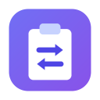
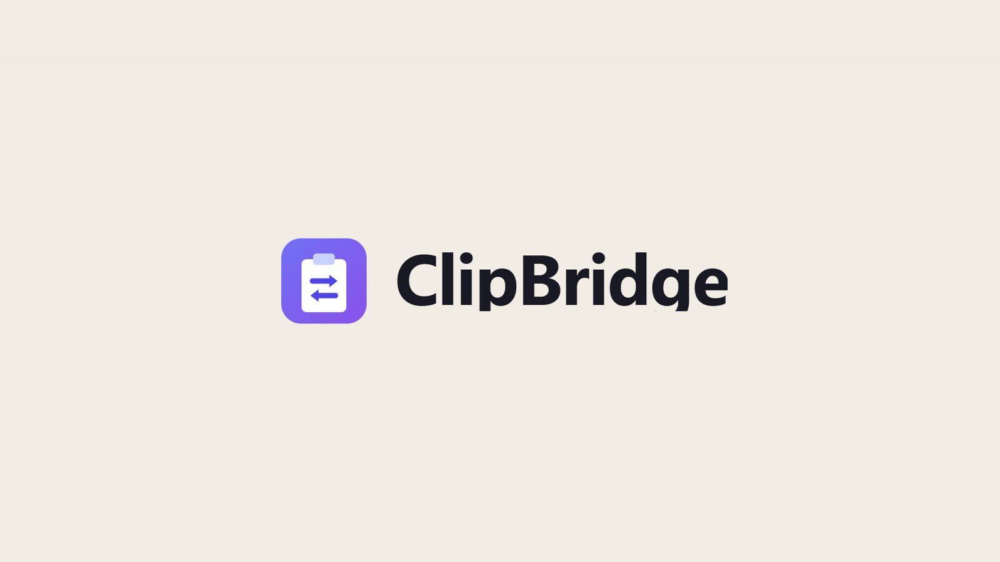

<p align="center"></p>

<h1 align="center">ClipBridge</h1>

<p align="center"><b>Copy on your Mac. Paste on your PC.</b> And the other way around.<br>
Free, open-source clipboard sync over your home Wi-Fi - with one shared history that never runs out.</p>

<p align="center">
  <a href="https://aiworldbyshachar.github.io/clipbridge/">Website &amp; demo video</a> ·
  <a href="https://github.com/aiworldbyshachar/clipbridge/releases/latest/download/ClipBridge-Windows-Setup.exe">Download for Windows</a> ·
  <a href="https://github.com/aiworldbyshachar/clipbridge/releases/latest/download/ClipBridge-macOS.dmg">Download for Mac</a> ·
  <a href="README.he.md">עברית</a>
</p>

<p align="center"><a href="https://aiworldbyshachar.github.io/clipbridge/#demo"></a></p>

---

If you work with a Mac and a PC on the same desk, you know the ritual: copy something on one, then email it to yourself, message it to yourself, or retype it - and get a letter wrong. ClipBridge makes the clipboard simply cross over.

- **Copy here, paste there.** Whatever you copy (⌘C / Ctrl+C) on one computer is in the other one's clipboard a moment later.
- **One shared history, no limit.** Everything copied on both computers is kept, with the device it came from. Search, star, copy again. Copies made while a computer was away sync when it's back.
- **Text, formatted text and images.** Formatting survives the trip; screenshots too.
- **Private.** No account, no server, no cloud - the computers talk directly on your network, encrypted with AES-256-GCM using a key derived from your connection code. Private mode pauses everything with one click.
- **Six languages.** English (default), Hebrew, Spanish, French, Russian and Arabic, with right-to-left layouts for Hebrew and Arabic.
- **Free and open source** under the MIT licence.

> **The one rule:** both computers must be on the **same local network** - the same Wi-Fi (or the same router, wired). ClipBridge never relays anything over the internet.

## Install

| | |
|---|---|
| **Windows 10/11** | Download [`ClipBridge-Windows-Setup.exe`](https://github.com/aiworldbyshachar/clipbridge/releases/latest/download/ClipBridge-Windows-Setup.exe) and run it. If SmartScreen says “Windows protected your PC”, click **More info → Run anyway**. When the firewall asks, click **Allow access** and make sure your home network is set to **Private**. |
| **macOS 12+** (Apple Silicon & Intel) | Download [`ClipBridge-macOS.dmg`](https://github.com/aiworldbyshachar/clipbridge/releases/latest/download/ClipBridge-macOS.dmg), open it and drag ClipBridge to Applications. On first launch, if macOS can't verify the app, go to **System Settings → Privacy & Security → Open Anyway**. Allow it to find devices on your local network. If macOS says the app is “damaged”, run `xattr -cr /Applications/ClipBridge.app` once in Terminal. |

The apps aren't signed with paid Apple/Microsoft developer certificates - that's why both systems ask once. You can also [build from source](#build-from-source).

## Connect your computers (once)

1. Open ClipBridge on the first computer → **Settings** (the icon at the top). Under **Connect your devices** you'll see a code like `K7QM-4XRT-P9WE`.
2. On the second computer: **Settings → Code from another device** → type the code → **Apply**.
3. Within a few seconds the top of the window says **Connected to …**. Done.

If they don't find each other, see **Settings → Other device not showing up?** - you can also add the other computer by its IP address (shown in its own settings).

## Use it

- Copy and paste as you always do.
- **History window:** click the tray / menu-bar icon (or the Dock icon on Mac), or press **Ctrl+Shift+Space** (Windows) / **⌘⇧Space** (Mac) - you can change the shortcut in Settings.
  - Start typing to search · ↑/↓ to pick · Enter or click copies the item · Esc closes.
  - ☆ stars an item, 🗑 deletes it on every device.
  - Filter by type, by starred, or by the device an item came from.
- **Pause (private mode):** from the tray menu or Settings.
- **Launch at login** and **Language:** Settings → General.

## Where your data lives

| | Windows | macOS |
|---|---|---|
| History & images | `%APPDATA%\ClipBridge\history` | `~/Library/Application Support/ClipBridge/history` |
| Settings | `%APPDATA%\ClipBridge\settings.json` | `~/Library/Application Support/ClipBridge/settings.json` |
| Troubleshooting log | `%APPDATA%\ClipBridge\clipbridge.log` | `~/Library/Application Support/ClipBridge/clipbridge.log` |

History is unlimited. **Clear history** in Settings clears it on all connected devices, except starred items. Uninstalling keeps your history.

## Troubleshooting

- **Always “Looking for devices…”** - both computers on the same network (not a guest network)? ClipBridge open on both? On Windows, the firewall must allow ClipBridge on Private networks; on Mac, **System Settings → Privacy & Security → Local Network → ClipBridge** must be on.
- **“Found … with a different connection code”** - enter one computer's code on the other.
- **Routers that block discovery** (common with mesh Wi-Fi) - add the other computer by IP in Settings. ClipBridge uses TCP port 47801 and UDP port 47800.
- **A VPN** on either computer can block local-network traffic.

## How it works

- `src/main/clipwatch.js` watches the clipboard (twice a second for text, every second for images).
- `src/main/store.js` - the history is a replicated event log (`history.jsonl`): every change carries the device that made it and a sequence number, so each computer knows exactly what it's missing from the other.
- `src/main/sync.js` - devices find each other with UDP broadcast and talk over HTTP, every message sealed with AES-256-GCM. A new copy arrives two ways at once: the copying computer pushes it, and each computer also keeps a long-poll open to the other that answers the moment something new appears - so delivery is instant even if only one side can accept connections. Anything missed is pulled on reconnect and every 30 seconds.
- `src/main/main.js` - tray, shortcut, window and IPC. The UI is in `src/renderer`; all strings, in all languages, are in `src/shared/i18n.js`.

## Build from source

```bash
npm install
npm start            # run from source
npm test             # sync and history tests
npm run dist:win     # Windows installer → dist/
npm run dist:mac     # macOS DMG → dist/ (on a Mac)
```

On a Mac, `bash scripts/build-mac.sh` builds the app and installs it into `/Applications` in one step. ClipBridge is pinned to Electron 43: Electron 44 replaced the clipboard API with a new async one, and the watcher is written for the classic API.

Releases are built by GitHub Actions: pushing a tag like `v1.1.0` builds both installers and publishes them (`.github/workflows/release.yml`).

### The demo video

The film on the website is code too: [`video/`](video) is a [HyperFrames](https://hyperframes.heygen.com) project (HTML + GSAP rendered to MP4), with narration, music and sound effects from ElevenLabs. Its UI is rebuilt from the app's own stylesheet and translations. To regenerate the audio you need your own ElevenLabs key in `.env` (`ELEVENLABS_API_KEY=…`, never committed); see `video/tools/elevenlabs.mjs`. The UI font is Segoe UI loaded from the system, so renders are made on Windows.

## Contributing

Issues and pull requests are welcome. Good first ideas: file transfer, more languages (add a table to `src/shared/i18n.js`), Linux support.

## More free tools

[FolderBridge](https://github.com/aiworldbyshachar/folderbridge) - save on your Mac, open on your PC, with one folder that stays identical on both computers.

## Licence

[MIT](LICENSE) - free to use, change and share.
